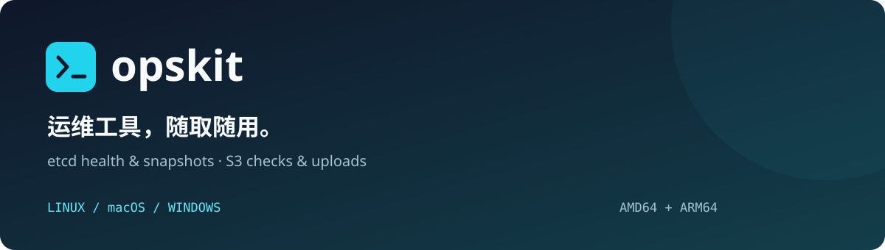

<p align="center">
  
</p>

<p align="center">
  <a href="https://github.com/sxxpqp/opskit/actions/workflows/ci.yml"></a>
  <a href="https://github.com/sxxpqp/opskit/releases/latest"></a>
  <a href="https://github.com/sxxpqp/opskit/releases"></a>
  <a href="https://github.com/sxxpqp/opskit/stargazers"></a>
</p>

<p align="center">
  <strong>一个 Go 运维工具箱，从 etcd 备份到 S3 归档。</strong><br>
  下载即用 · 六种平台构建 · 本地备份可追踪
</p>

<p align="center">
  <a href="#快速上手">快速上手</a> ·
  <a href="#下载">下载</a> ·
  <a href="#etcd-备份">使用指南</a> ·
  <a href="#路线图">路线图</a> ·
  <a href="https://github.com/sxxpqp/opskit/issues/new/choose">反馈与建议</a>
</p>

## 为什么做 opskit

备份 etcd、记录校验信息、再把文件传到对象存储，这些日常操作经常散落在不同脚本里。opskit 希望把它们收进一套清楚、可重复执行的命令中，让服务器、个人电脑和自动化任务使用同一个入口。

项目正在早期迭代，当前重点是 **etcd 快照与 S3 上传**。网络排查、更多数据库备份和保留策略将逐步加入。

## 现在能做什么

| 能力 | 当前行为 |
|---|---|
| etcd 快照 | 调用官方 `etcdctl`，支持 CA、客户端证书与任务超时 |
| 备份清单 | 为每次任务生成独立目录，记录文件大小、SHA-256 和上传状态 |
| S3 上传 | 内置 Go SDK，支持自定义 endpoint、region 和 path-style |
| 失败保留 | 上传失败仍保留完整本地快照，便于排查和重试 |
| 跨平台交付 | Windows / Linux / macOS，amd64 与 arm64，直接下载可执行文件 |

S3 兼容服务的后端能力需实际验证。etcd 备份需要单独安装匹配版本的 `etcdctl`；当前尚未完成真实环境的恢复验收。

## 快速上手

以 Linux x86_64 为例，下载后运行；其他平台见下方下载表。

```sh
curl -fL https://github.com/sxxpqp/opskit/releases/latest/download/opskit_linux_amd64 -o opskit
chmod +x opskit
./opskit version
./opskit etcd backup --help

# 本地开发环境示例：先安装 etcdctl，并确认 etcd 已在该地址运行
./opskit etcd backup --endpoint http://127.0.0.1:2379 --directory ./backups
```

生产环境的 TLS 连接和 S3 上传示例见下文。下载文件可先按 Release 附带的 `checksums.txt` 校验。

## 下载

**[下载最新版本](https://github.com/sxxpqp/opskit/releases/latest)** · [查看历史版本与更新说明](https://github.com/sxxpqp/opskit/releases)

公开附件无需登录 GitHub，选好系统和 CPU 架构即可下载。

| 系统 | x86_64 / amd64（Intel、AMD 64 位） | ARM64 / aarch64 |
|---|---|---|
| Windows | [下载 EXE](https://github.com/sxxpqp/opskit/releases/latest/download/opskit_windows_amd64.exe) | [下载 EXE](https://github.com/sxxpqp/opskit/releases/latest/download/opskit_windows_arm64.exe) |
| Linux | [下载二进制](https://github.com/sxxpqp/opskit/releases/latest/download/opskit_linux_amd64) | [下载二进制](https://github.com/sxxpqp/opskit/releases/latest/download/opskit_linux_arm64) |
| macOS | [Intel 芯片下载](https://github.com/sxxpqp/opskit/releases/latest/download/opskit_darwin_amd64) | [Apple 芯片下载](https://github.com/sxxpqp/opskit/releases/latest/download/opskit_darwin_arm64) |

这里的 x86 指 64 位 x86_64，不提供 32 位 x86 安装包。下载后将文件重命名为 `opskit`（Windows 为 `opskit.exe`）；Linux/macOS 执行 `chmod +x opskit` 后运行，无需解压。可下载 [SHA-256 校验文件](https://github.com/sxxpqp/opskit/releases/latest/download/checksums.txt) 校验完整性。


## etcd 备份

```sh
opskit etcd backup --endpoint https://127.0.0.1:2379 \
  --cacert ./ca.crt --cert ./client.crt --key-file ./client.key \
  --directory ./data/backups/etcd --timeout 30m
```

只指定一个 endpoint；也可使用 `ETCDCTL_ENDPOINTS`、`ETCDCTL_CACERT`、`ETCDCTL_CERT`、`ETCDCTL_KEY`、`ETCDCTL_USER` 等 etcdctl 环境变量。密码不要放在命令参数里。工具直接执行 etcdctl，不经过 shell。默认保留 TLS 验证。

每个任务使用独立目录，保存 `snapshot.db` 与 `manifest.json`（大小、SHA-256、时间、上传状态）。失败快照保留 `.partial`；上传失败保留完整本地备份并返回退出码 5。当前不自动清理备份。

```sh
# 快照备份后上传；默认生成唯一的 etcd/<task>/snapshot.db key
opskit etcd backup --endpoint https://127.0.0.1:2379 \
  --bucket backups --s3-endpoint https://s3.example.com --path-style

# 单独上传已有文件，也可用于上传失败后的重试（使用新 key）
opskit s3 upload --bucket backups --key manual/snapshot.db \
  --s3-endpoint https://s3.example.com --path-style ./snapshot.db
```

S3 凭据使用 AWS SDK 默认凭据链，例如 `AWS_ACCESS_KEY_ID`、`AWS_SECRET_ACCESS_KEY`、可选 `AWS_SESSION_TOKEN` 或工作负载角色。支持 AWS S3、MinIO 等 S3 兼容服务（需实际验证后端能力），不自动创建 bucket。默认 region 为 `us-east-1`，可用 `--region` 修改。所有参数须放在位置文件参数前。

上传采用分段上传，默认禁止覆盖已存在对象，要求后端支持条件写；不支持时应报错。上传后 HEAD 核对长度和 SHA-256 metadata，验证数据对象后才上传远端 manifest。metadata 验证不代表远端内容回读校验。若上传完成但 HEAD 或清单失败，请检查远端已有对象，重试时指定新 key。任务总超时包含快照和上传。

## 校验和恢复演练

```sh
etcdutl snapshot status ./snapshot.db -w table
# 仅在隔离环境恢复，勿指向正在运行的生产数据目录
etcdutl snapshot restore ./snapshot.db --data-dir ./restore-test
```

快照流程依据 [etcd 官方恢复文档](https://etcd.io/docs/v3.6/op-guide/recovery/)。本项目尚未完成真实 etcd/MinIO 环境的恢复验收，生产使用前应进行恢复演练并核对业务数据。

## 路线图

下面是演进方向，未勾选的功能尚未实现。欢迎在 Issue 中分享使用场景，帮助确定优先级。

- [x] etcd 快照、SHA-256 清单、失败保留
- [x] S3 兼容上传与远端 metadata 验证
- [x] Windows / Linux / macOS 双架构构建与自动发布
- [ ] 真实 etcd / S3 集成测试与隔离恢复演练
- [ ] 配置文件与备份保留策略
- [ ] S3 下载、列举与内容回读校验
- [ ] MySQL / PostgreSQL 逻辑备份
- [ ] TCP / DNS / HTTP 下载 / ICMP 网络排查
- [ ] Linux ss / netstat 连接查看

完整思路见 [设计文档](go-opskit-design.md)。设计文档描述目标，以上清单反映当前实现。

## 参与项目

如果 opskit 对你有帮助，欢迎点个 **Star**，也欢迎通过 **Watch → Releases** 关注新版本。

更期待你带着实际问题参与：[报告 Bug](https://github.com/sxxpqp/opskit/issues/new?template=bug_report.yml)、[提出需求](https://github.com/sxxpqp/opskit/issues/new?template=feature_request.yml)，或提交一个小而清晰的 PR。反馈时请注明系统、架构、工具版本和复现步骤，移除密码、密钥与业务数据。

开发与提交方式见 [贡献指南](CONTRIBUTING.md)。

## 本地开发与发布

Go 版本见 [go.mod](go.mod)。

```sh
go build -o opskit ./cmd/opskit
go test ./...
go test -race ./...
go vet ./...
```

每次 main 提交自动测试并构建，开发产物位于 Actions 的 `opskit-packages`。创建并推送新的 `v*` 标签后，三平台测试与六架构构建全部通过才自动发布公开 Release：

```sh
git tag v0.1.2
git push origin v0.1.2
```

仅在本地创建标签不会触发。每个版本使用新标签，已有版本不重复发布。
